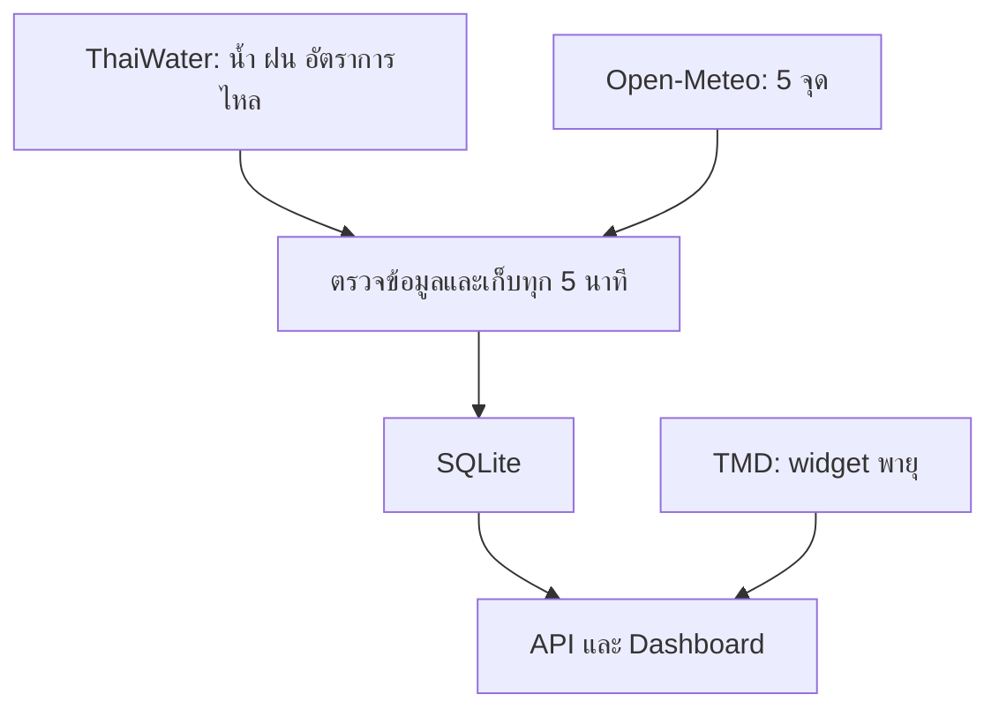

# FloodLens / ลาดกระบัง

สำรวจฝนและระดับน้ำบริเวณ KMITL และพื้นที่ใกล้เคียง ไม่ใช่ระบบแจ้งเตือนภัย

## FloodLens Monitor

รุ่นนี้เป็นระบบติดตามที่มีตัวเก็บข้อมูลเบื้องหลัง ฐานข้อมูล SQLite และหน้าดูสถานี/ประวัติ ไม่ใช่แค่หน้าแสดง snapshot ผู้ใช้ต้องรีสตาร์ท `python app.py` หลังอัปเดตจากรุ่นเดิม

- เลือกพื้นที่รอบ KMITL 10 กม. หรือบริบทภูมิศาสตร์รอบจุดเดียวกัน 150 กม. รวมสถานีแม่น้ำ/คลองในกรุงเทพฯ และพื้นที่ใกล้เคียง ไม่ใช่ขอบเขตลุ่มน้ำ
- เพิ่ม feed `flow` ของ ThaiWater ซึ่งรวมสถานี กทม. (`flow_value`, ลบ.ม./วินาที) รักษาค่าบวก/ลบไว้ ไม่เดาว่าทิศบวกคือทิศใด
- แผนผังพิกัดสถานี ค้นหาคลอง/จังหวัด/ลุ่มน้ำ คลิกดูประวัติ 24/48 ชม., 7/30 วัน และดาวน์โหลด CSV
- เก็บค่าตรวจวัดทุก 5 นาทีใน `data/floodlens.sqlite3` แม้ไม่มีหน้าเว็บเปิด ต้องปล่อย process ทำงานอยู่ ข้อมูลเดิมยังอยู่หลังปิดและเปิดใหม่; ไม่ได้ติดตั้ง Windows Service
- ประวัติเริ่มสะสมหลังเปิดรุ่นนี้ ไม่ได้ดาวน์โหลดข้อมูลย้อนหลังมาเติม แนวโน้มใช้สองค่าล่าสุดจริงที่ห่างกันไม่เกิน 3 ชม. และไม่เก่ากว่า 3 ชม. ไม่มีคู่ข้อมูลจะไม่คำนวณ
- ฝนสะสม 24 ชม. บันทึกเป็น snapshot ตามสถานี ไม่รวม/ลบเพื่ออ้างว่าเป็นฝนแต่ละชั่วโมง ส่วนพยากรณ์เป็นข้อมูลแบบจำลองแยกต่างหาก
- พยากรณ์ 5 จุด: KMITL, ปทุมธานี, อยุธยา, ฉะเชิงเทรา, กรุงเทพฯ ชั้นใน แสดงฝนและลมที่ความสูง 10 เมตร หน่วยลม กม./ชม. ลูกศรชี้ทิศที่ลมพัดไป (`wind_from_deg + 180`) ไม่ใช่ทิศการเคลื่อนตัวของพายุ
- ภาพเส้นทางพายุฝังจาก widget ทางการ TMD (`https://www.tmd.go.th/StromTrack`) พร้อมปุ่มเปิดต้นทาง ไม่ได้อ่านพิกัดศูนย์กลางพายุหรือคำนวณระยะถึงลาดกระบัง
- เก็บ `/csv` ไว้สำหรับวิเคราะห์ CSV เดิม ข้อมูลจำลองไม่เข้าฐานข้อมูลตรวจวัด

### การทำงานและ API



| Endpoint | ใช้ทำอะไร |
|---|---|
| `/api/live?scope=local` | snapshot ในรัศมี 10 กม. (ค่าเริ่มต้น) |
| `/api/live?scope=regional` | snapshot ในรัศมี 150 กม. พร้อมสถานะระบบและลมหลายจุด |
| `/api/history?feed=water&station_id=3&hours=48` | ประวัติสถานี; feed เป็น water/rain/flow, hours 1–720, สูงสุด 5,000 จุดล่าสุด |
| `/api/health` | สถานะ collector และแต่ละ feed |
| `/api/data` | CSV เดิม |

หน้าเว็บอ่าน snapshot โดยไม่รอ upstream รอบใหม่ ระหว่างรอบแรกจะแสดง `pending`; ต้นทางล้มเหลวแสดง `error` และตารางปัจจุบันว่าง แต่ประวัติไม่ถูกลบ ตรวจเวลาตรวจวัดใหม่ทุกครั้งที่อ่าน snapshot; สำเนาที่ไม่ได้ดึงใหม่เกิน 15 นาทีมี `cache_stale` และถือว่าจุดวัดเก่า บันทึกเวลาซ้ำของ feed/สถานีเดียวกันเพียงครั้งเดียว และยอมรับค่าต้นทางที่แก้ไข timestamp เดิม เก็บ metadata การดึง 1,000 รอบล่าสุด ไม่ลบประวัติตรวจวัดอัตโนมัติ

```powershell
# รันระบบ (ฐานข้อมูลเริ่มต้น data/floodlens.sqlite3)
python app.py
# เก็บจริงหนึ่งรอบ แล้วจบ (ไม่ต้องเปิด server)
python app.py --collect-once
# ระบุฐานข้อมูลเอง
python app.py --db data/my_archive.sqlite3 --port 8000
# ตรวจตรรกะ Python และหน้าเว็บด้วย mock DOM (ต้องมี Node.js เพื่อทดสอบส่วน JS)
python -m unittest discover -s tests -v
node --test tests/dashboard.test.cjs
```

ฐานข้อมูลและไฟล์ WAL/SHM ไม่เข้า git สำรอง SQLite ขณะหยุด server หรือใช้ SQLite backup API เพื่อความสอดคล้อง อย่าเก็บเฉพาะไฟล์หลักขณะที่มี WAL ค้าง ขณะนี้ยังไม่มีระบบ retention ของข้อมูลตรวจวัด ให้ติดตามขนาดฐานข้อมูลเมื่อใช้งานต่อเนื่อง

### ขอบเขตทางน้ำและพายุ

ปริมาณไหลผ่านสถานี A กับ B อาจเป็นน้ำก้อนเดียวกันในคนละจุด ไม่ควรบวกเป็นยอดไหลเข้าลาดกระบัง ข้อมูลระดับน้ำเพียงอย่างเดียวไม่พิสูจน์ทิศไหล ความสัมพันธ์ระหว่างฝนกับระดับน้ำไม่พิสูจน์ว่าเป็นน้ำจากต้นทางนั้น การคำนวณเวลาถึงพื้นที่ต้องมีโครงข่ายคลองจริง จุดเชื่อม ประตู เครื่องสูบ ระดับปลายทาง/น้ำทะเล และพารามิเตอร์แบบจำลอง

แหล่งข้อมูลที่ตรวจอ่านประกอบในรอบนี้:

- [จุดเฝ้าระดับน้ำรอบ KMITL](https://www.opre.kmitl.ac.th/main/?page_id=2059): ประเวศบุรีรมย์ ลาดกระบัง สองต้นนุ่น คลองสาม คลองสี่ ลำปลาทิว
- [สถานีอัตราการไหล กทม.](https://weather.bangkok.go.th/Flow/): หน่วย ลบ.ม./วินาที พร้อมเวลาวัด; parser ใช้ JSON ผ่าน ThaiWater
- [บริบทการบริหารน้ำฝั่งตะวันออก](https://edunakhonsawan.prd.go.th/th/content/category/detail/id/33/iid/547207): ตัวอย่างการใช้บางชัน/แสนแสบและผันน้ำเพื่อลดภาระประเวศฯ เป็นบริบทจากเอกสาร ไม่ใช่ telemetry ประตูแบบสด
- [เอกสารลมและฝน Open-Meteo](https://open-meteo.com/en/docs): request 3 วันปฏิทินจึงเหลือน้อยกว่า 72 ชั่วโมงเมื่อกรองเวลาที่ผ่านไปแล้ว
- [วิธีฝัง widget พายุ TMD](https://www.tmd.go.th/weatherWidget/StromTrack): ระบุ iframe `/StromTrack` อย่างเป็นทางการ การแสดงผลขึ้นกับต้นทาง ต้องตรวจวันเวลาบนภาพเอง

ยังไม่มีแบบจำลองเส้นทางน้ำ/เวลามาถึง สถานะประตู/เครื่องสูบแบบสด น้ำทะเลหนุนแบบอัตโนมัติ หรือการคำนวณเส้นทางศูนย์กลางพายุ หากต้องการยกระดับถัดไปควรเพิ่มข้อมูลเหล่านี้ก่อนสร้างการแจ้งเตือน

## เริ่มใช้งาน

ใช้ Python 3.12 ขึ้นไป ไม่ต้องติดตั้งแพ็กเกจเพิ่ม

```powershell
python app.py
```

เปิด http://127.0.0.1:8000 แล้วเลือกโหมด API หรือ CSV กด Ctrl+C เพื่อหยุด

```powershell
python -m unittest discover -s tests -v
python app.py --data data/my_observations.csv --port 8000
```

## ข้อมูล API

`GET /api/live` ส่งสถานะของแต่ละ feed แยกกัน (`pending`, `ok`, `empty`, `error`) พร้อม URL ต้นทางและเวลาที่ดึงสำเร็จ ตัวเก็บข้อมูลดึงสี่ feed พร้อมกัน จำกัดเวลารอแหล่งละ 15 วินาที ไม่ใช้ข้อมูลจำลองแทนเมื่อ API ขัดข้อง

- จุดอ้างอิงโดยประมาณ KMITL: 13.73, 100.78
- สถานีตรวจวัด: กรองตามระยะวงกลมไม่เกิน 10 กม. ไม่ใช่ขอบเขตเขตลาดกระบัง และไม่ได้ยืนยันว่าทุกสถานีอยู่ในคลองที่เชื่อมกับมหาวิทยาลัย
- น้ำ: https://api-v3.thaiwater.net/api/v1/thaiwater30/public/waterlevel_load — ใช้ `waterlevel_msl` หน่วย ม.รทก. ไม่ใช่ความลึกน้ำท่วมและไม่ใช่อัตราการไหล
- ฝนตรวจวัด: https://api-v3.thaiwater.net/api/v1/thaiwater30/public/rain_24h — ใช้ `rain_24h` เป็นค่าฝนสะสม 24 ชั่วโมงล่าสุดต่อสถานี ไม่รวมค่าหลายสถานีหรือช่วงสะสมที่ซ้อนกัน
- พยากรณ์: https://open-meteo.com/en/docs — precipitation และ precipitation_probability รายชั่วโมง 3 วัน ตั้งเวลา Asia/Bangkok และใช้ Unix timestamp แปลงเป็น ISO 8601 ที่มี +07:00 แสดงเฉพาะชั่วโมงที่ยังไม่ผ่าน ณ เวลาดึงข้อมูล
- แสดงตำแหน่งสถานีและระยะใน JSON พิกัดกริดแบบจำลองอยู่ใน `grid_latitude` / `grid_longitude`
- ข้อมูลสถานีอายุเกิน 3 ชั่วโมงหรือเวลาอยู่อนาคตเกิน 15 นาทีจะแสดงคำเตือน ไม่ใช้ค่าเป็นศูนย์แทนข้อมูลที่ขาด

### สถานะการตรวจสอบ

ตรวจสอบข้อมูลจริงผ่านเบราว์เซอร์ที่ `http://127.0.0.1:8000/api/live` แล้วเมื่อ 23 พฤศจิกายน 2026 เวลา 20:46 น. (ไทย) ทั้งสาม feed มีสถานะ `ok`: น้ำ 2 สถานี ฝน 11 สถานี และพยากรณ์ 51 ชั่วโมงถัดไป ณ เวลาตรวจสอบ ตัวอย่างคลองลำปลาทิว ลาดกระบัง: -0.22 ม.รทก. เวลา 20:30 น.; ฝนใกล้ รพ.ลาดกระบัง: 0 มม./24 ชม. เวลา 20:00 น. จำนวนระเบียนและค่าจะเปลี่ยนตามเวลาที่ดึง

ข้อผิดพลาด DNS/socket ที่พบใน shell ของ agent ไม่ใช่หลักฐานว่าแอปที่ผู้ใช้รันอยู่ดึงข้อมูลไม่ได้ การตรวจสอบข้างต้นเกิดผ่านแอปจริง ไม่ใช่ fixture และไม่ได้แก้การตั้งค่าเครือข่ายหรือปิดการตรวจสอบ TLS

ตัวเชื่อม ThaiWater ใช้ public feed ของเว็บไซต์ ไม่ใช่ API ที่รับประกันสัญญารูปแบบข้อมูลหรือความพร้อมใช้งาน หาก schema ไม่ตรงจะแสดงข้อผิดพลาดแทนข้อมูลว่าง ทดสอบอัตโนมัติใช้ข้อมูลจำลองเพื่อทดสอบตรรกะแยกจากการตรวจสอบ live

ตรวจการดึงข้อมูลจริงโดยไม่เปิด server เพิ่ม:

```powershell
python app.py --check-live
```

คำสั่งส่ง JSON พร้อมสถานะและ URL ต้นทาง Exit code เป็น 0 เมื่อทุก feed เป็น `ok`; เป็น 1 หากมี feed ว่างหรือผิดพลาด ใช้จาก terminal ปกติที่เชื่อมต่ออินเทอร์เน็ตได้ ไม่ใช่ shell ที่ถูกจำกัดเครือข่าย ข้อมูลจะถูกดึงใหม่ใน process นี้ ไม่ใช้ cache ของ server เดิม

ไม่ได้เชื่อม SWOC ที่รองรับ JWT เพราะยังไม่มีสิทธิ์หรือ token ที่ยืนยันใช้งานได้ ไม่ต้องใส่ secret ในหน้าเว็บ

Open-Meteo: ให้เครดิต Weather data by Open-Meteo.com / CC BY 4.0 และตรวจสอบเงื่อนไข https://open-meteo.com/en/terms ก่อนใช้เชิงพาณิชย์
ThaiWater: ให้เครดิต สสน. และหน่วยงานเจ้าของสถานี ตรวจสอบสิทธิ์การใช้ต่อกับต้นทาง

## CSV เดิม

`GET /api/data` อ่านไฟล์ตอนเริ่ม server เปลี่ยนไฟล์แล้วต้องเริ่ม server ใหม่

```csv
timestamp,station_id,rain_mm,water_level_m,source,is_demo
2026-10-01T00:00:00+07:00,DEMO-KMITL-01,0,0.2,synthetic,true
```

`data/demo.csv` เป็นข้อมูลจำลอง ใช้ทดลองหน้าจอ ไม่ใช่หลักฐานเหตุการณ์น้ำท่วมจริง ช่องว่างเป็น null ไม่ใช่ศูนย์ timestamp ต้องมี timezone ฝนต้องไม่ติดลบ ระดับน้ำติดลบได้ตามจุดอ้างอิง ห้ามนำค่าฝนสะสม 24 ชั่วโมงที่ซ้อนกันมาแปลงเป็นฝนแต่ละชั่วโมงแล้วรวมยอด

โหมด CSV มีตัวกรองสถานี วันที่ และดาวน์โหลด CSV ส่วน API แสดงตารางระดับน้ำ ฝนสะสม และกราฟแท่งพยากรณ์แยกกัน

## Community photo reports

Open `/report` from the dashboard to submit a public situation report.
The form accepts one JPEG/PNG up to 3 MB, a location description, incident details,
and optional device coordinates. Submissions are saved in the configured SQLite
file (`--db`) and receive a reference ID; the latest 50 are displayed as unverified.
Photos and coordinates are visible to everyone who can access this local server.
The homepage lists recent reports within 10 km of the campus reference point and
includes text-only locations as reported. Search by landmark or report details.
Reports awaiting an update are marked after six hours without a new report or
coordinator confirmation. Display names are optional and public.

This is a local prototype. Image validation checks size and file signatures, not
full image decoding; metadata is not stripped. Do not publish this prototype as a
public upload service without addressing these limitations and abuse/storage limits.
The server continues to bind to 127.0.0.1; mobile access needs a separately configured
host and secure context for camera/geolocation support. No external notifications
are sent by this feature.

Verify with `python -m unittest discover -s tests` and
`node --check web/reports.js`. Restart `python app.py`, visit `/report`, submit a
photo, and verify the reference ID, latest listing, and image after a restart.

### Private help requests

Open `/help` from the homepage or the public report page. A request can be sent
using a landmark and number of people, with optional contact and device coordinates.
Save the tracking link to see when a coordinator accepts or closes the request.
The tracking link reveals status and timestamps only. Contact details and precise
coordinates are available through the protected coordinator queue.

Set `FLOODLENS_COORDINATOR_KEY` to a random secret of at least 32 characters before
starting the server. Open `/coordinator` and enter that secret to list, accept,
assign, or close cases. Set `FLOODLENS_HELP_TEAM`, `FLOODLENS_HELP_HOURS`, and
`FLOODLENS_HELP_CONTACT` together once the team confirms its coverage and contact
channel. Without that configuration the form shows coverage as unconfirmed.
Saving a request does not notify emergency responders.
If sending stalls, retry in the same tab. The form keeps the submitted data and
uses the same request key so a lost response does not create a second case.

Restart `app.py` after updating the checkout. Check that
`http://127.0.0.1:8000/help` returns HTTP 200 before testing the workflow.
